# BloomGuard - Bloom Filter-based Fraud/Spam Checker

Course project for Data Structures and Algorithms (DSA).

BloomGuard answers one question quickly and with very little memory: **"have I seen this
identifier before?"** (a transaction ID, email, URL, IP address or phone number) against a large
blacklist.

It uses a **two-stage check**:

```
item --> normalize --> Bloom filter (memory, O(k))
                         |-- "definitely not present" --> CLEAN            (fast path, no database)
                         `-- "probably present"       --> SQLite exact lookup
                                                           |-- found     --> BLACKLISTED
                                                           `-- not found --> FALSE POSITIVE
```

The Bloom filter never gives a false negative. Its occasional false positives are removed by the
exact SQLite lookup, so the slow path only runs for a small fraction of traffic.

Everything about the design is in `docs/` (PRD, TRD, APP_FLOW, BACKEND_SCHEMA, IMPLEMENTATION_PLAN). The manual test steps are in `docs/TESTING_CHECKLIST.md`.

---

## Screenshots

| | |
|---|---|
| 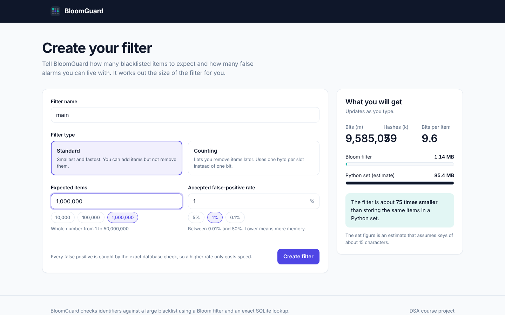 **Setup**: live calculator for the filter size | 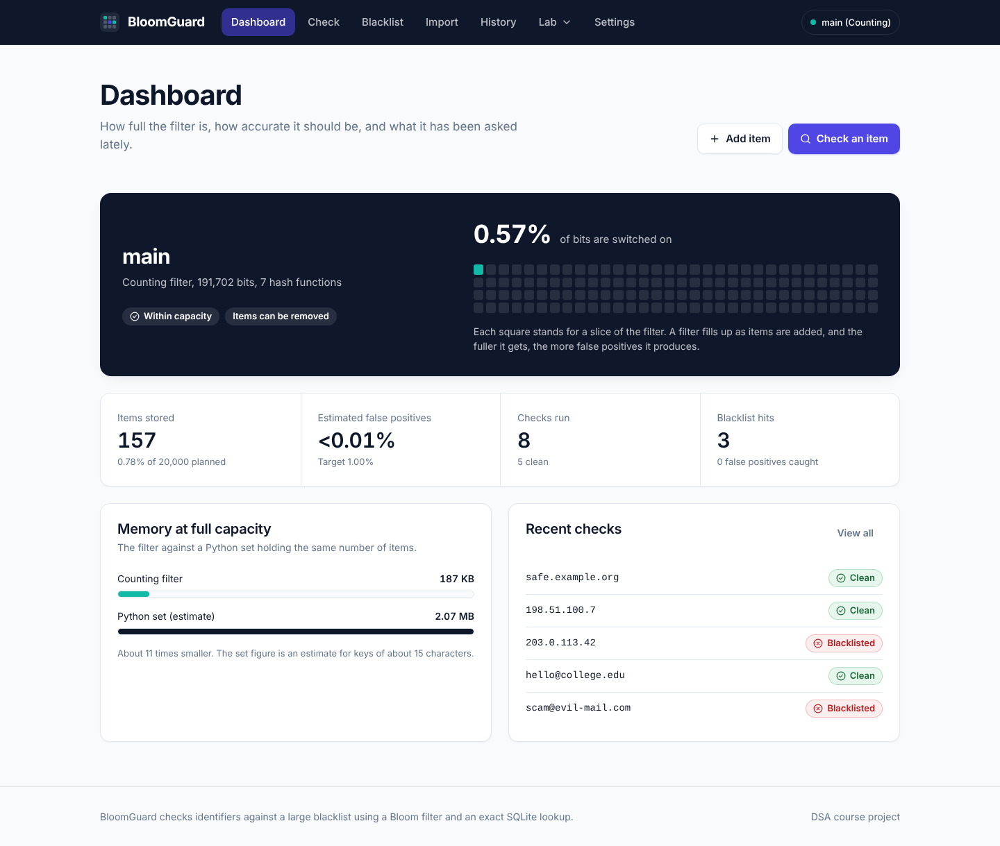 **Dashboard**: fill level, counters, memory comparison |
| 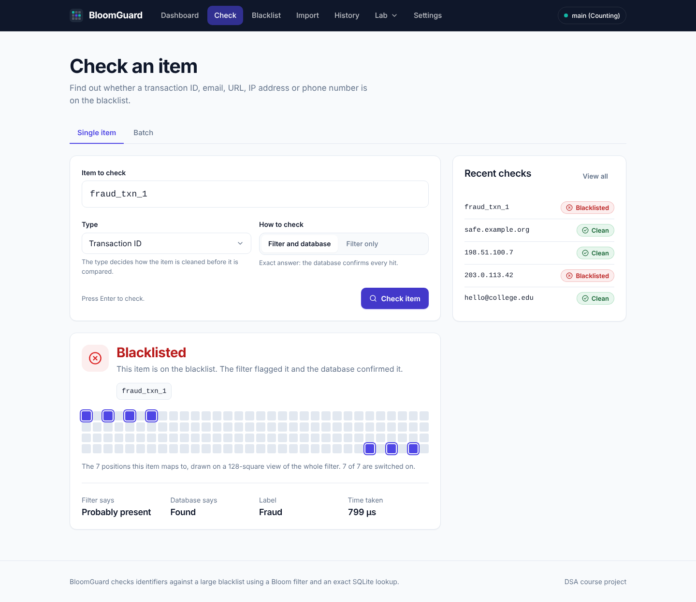 **Check**: the verdict and the bits the item touches | 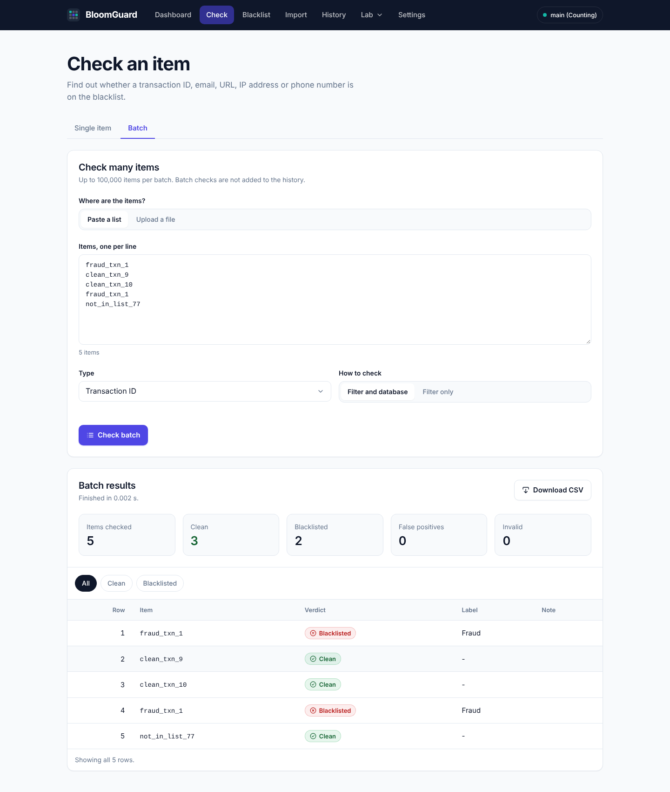 **Batch check**: summary and filterable results |
| 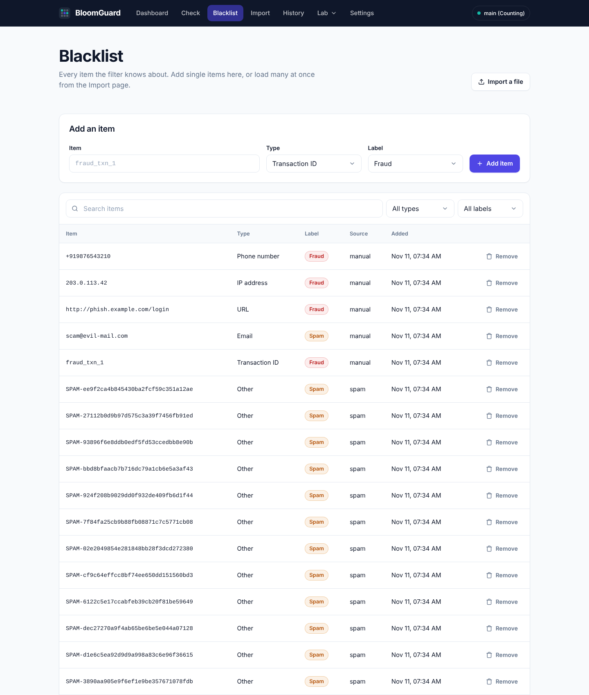 **Blacklist**: search, filter, remove | 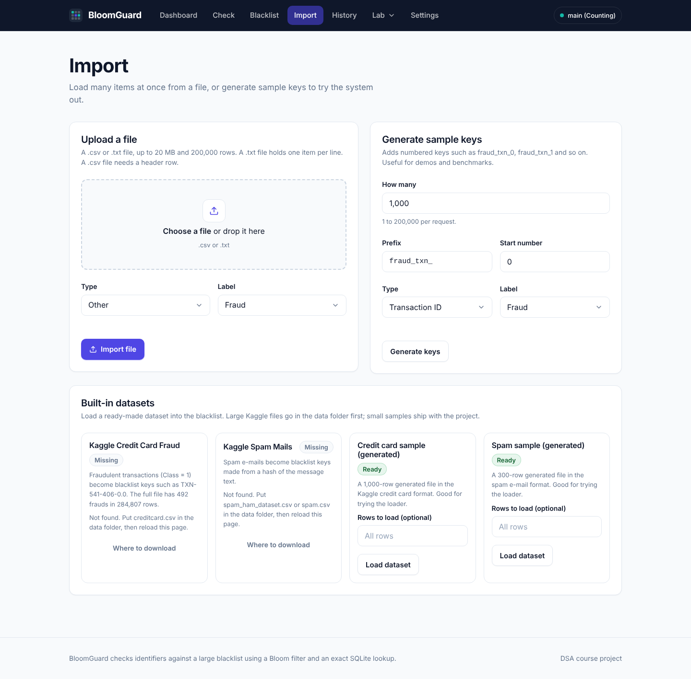 **Import**: CSV upload, built-in datasets, generator |
| 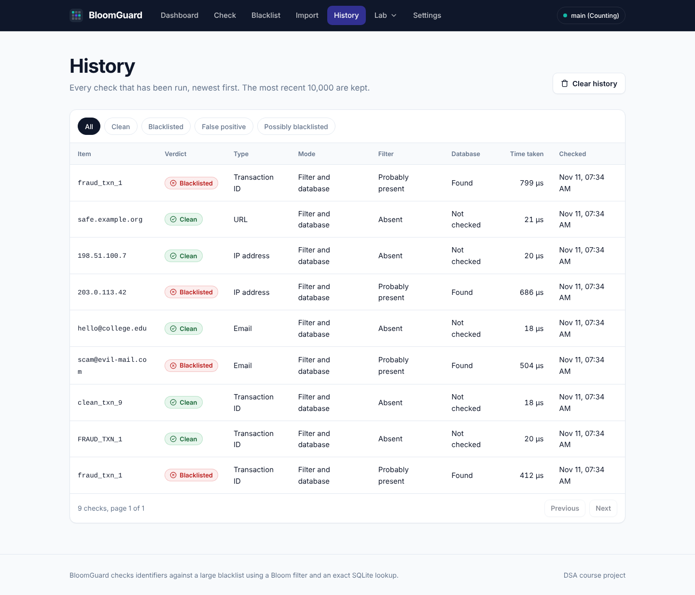 **History**: every single check, by verdict | 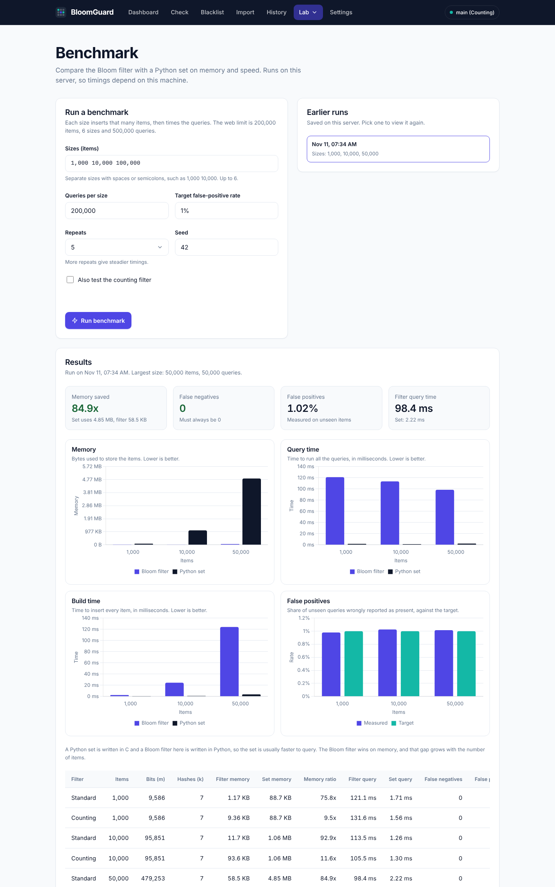 **Benchmark**: filter against a Python set |
| 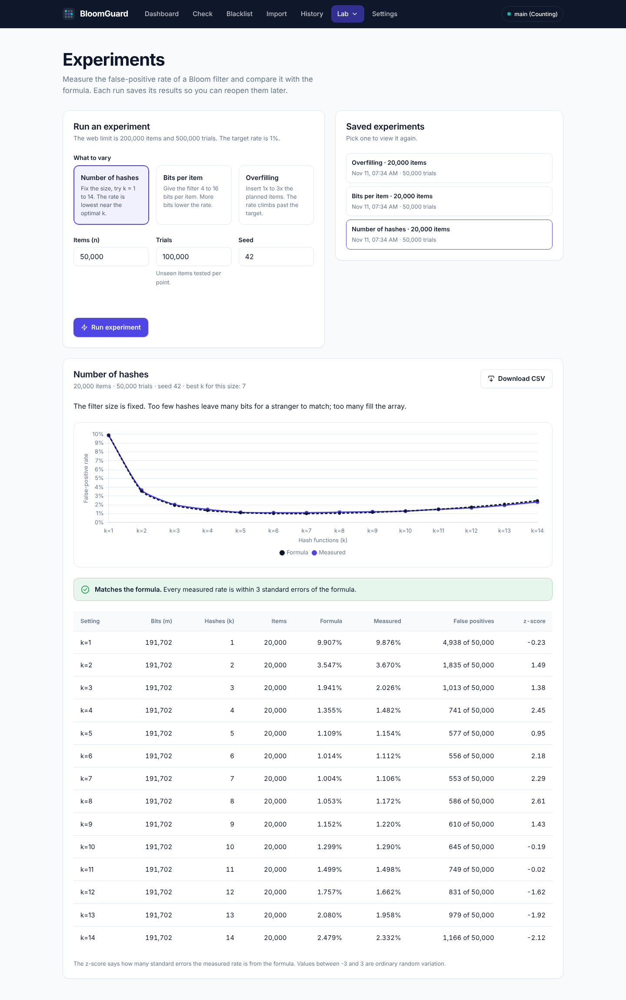 **Experiments**: measured against the formula | 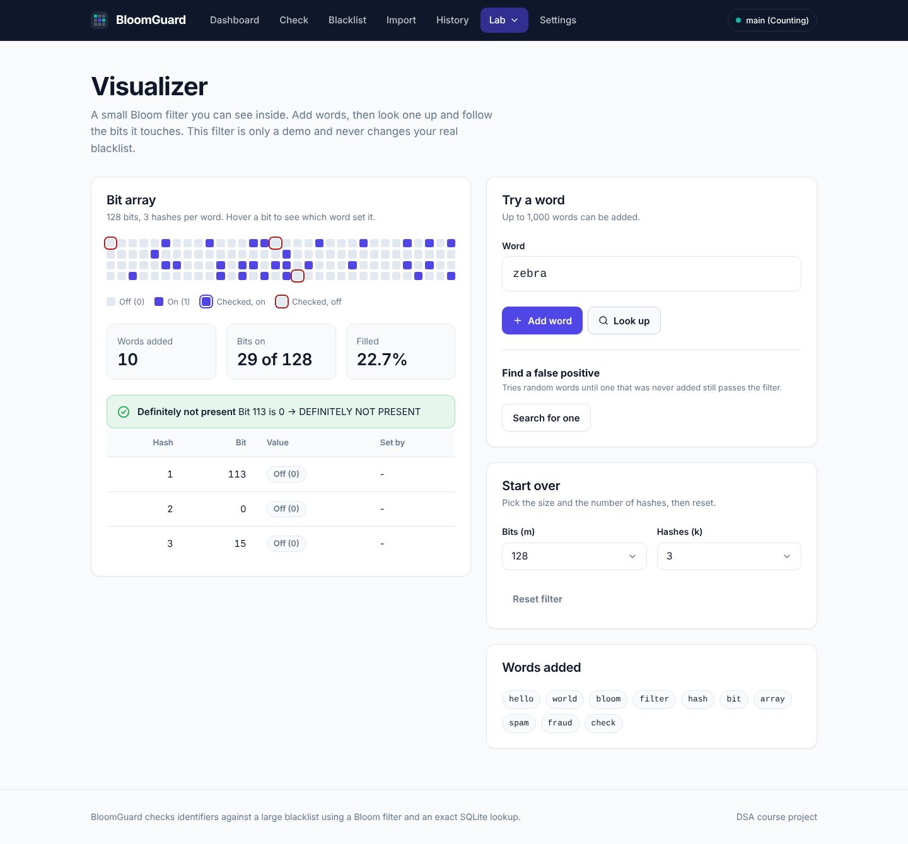 **Visualizer**: watch the bits switch on |

On a phone the tables turn into stacked cards and the navigation collapses into a menu:

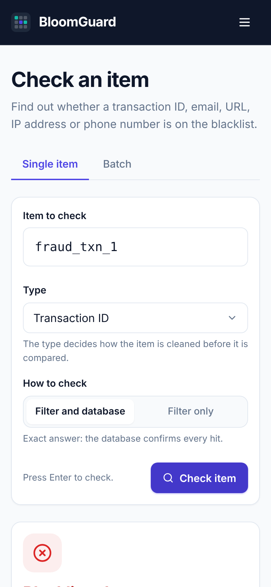

## Pages

| Page | Address | What it does |
|---|---|---|
| Setup | `/setup` | First run only. Calculates the filter size from the item count and target false-positive rate. |
| Dashboard | `/` | Fill level, estimated false-positive rate, counters, memory against a Python set. |
| Check | `/check` | One item (two-stage or filter-only), or a batch of up to 100,000 pasted or uploaded. |
| Blacklist | `/blacklist` | Add, search, filter and remove items. |
| Import | `/import` | CSV or text upload, the Kaggle datasets (or their small samples), synthetic keys. |
| History | `/history` | Past single checks, filtered by verdict. |
| Benchmark | `/benchmark` | Memory and speed of the filter against a Python set. |
| Experiments | `/experiments` | False-positive rate against the formula while varying k, bits per item, or overfilling. |
| Visualizer | `/visualizer` | A 128-bit demo filter that explains each lookup bit by bit. Separate from the real filter. |
| Settings | `/settings` | Rebuild with new parameters, or reset everything. |

The pages are plain HTML, CSS and JavaScript (no framework). The design tokens are at the top of
`static/css/style.css`. Chart.js is stored in `static/vendor/`, so the charts work offline.

---

## 1. Setup (Windows, Python 3.10.11)

```powershell
git clone https://github.com/pranavkangude/spam_checker_via_bloom_filter.git
cd spam_checker_via_bloom_filter

python --version                  # must print Python 3.10.11
py -3.10 -m venv .venv            # use this form if several Python versions are installed
.venv\Scripts\Activate.ps1        # Command Prompt: .venv\Scripts\activate.bat
python --version                  # confirm again inside the virtual environment
python -m pip install --upgrade pip
pip install -r requirements.txt
```

If PowerShell blocks the activation script, run once:
`Set-ExecutionPolicy -Scope CurrentUser RemoteSigned`

`requirements.txt` pins pandas below 3 because pandas 3 needs Python 3.11 or newer.

## 2. Run

```powershell
python app.py                     # http://127.0.0.1:5000
```

On first start there is no filter, so every page redirects to `/setup`. Create a filter there
(or `POST /api/filter`) and the dashboard opens. Stop the server with `Ctrl+C`.

Quick check that the server is alive: open `http://127.0.0.1:5000/api/health`.

## 3. Test

```powershell
pytest -q                         # whole suite (465 tests), about 1 minute
pytest tests/test_integration.py -q
```

All tests must pass on Python 3.10.11 before a pull request is merged.

## 4. Where things live

```
app.py                 Flask app factory, error handlers, page routes, startup
api.py                 JSON routes (filter, blacklist, check, history, benchmark, experiments, visualizer)
api_extra.py           Routes for datasets and batch check (Member C)
core/                  The data structures: no Flask, no database
  params.py              m, k and false-positive formulas
  hashing.py             SHA-256 + MD5 double hashing
  bloom.py               BloomFilter (+ save/load with CRC32)
  counting_bloom.py      CountingBloomFilter (supports remove)
  normalizer.py          per-key-type cleaning
  estimates.py           memory estimates
  visualizer.py          teaching filter for the bit-grid page
services/              Business logic used by the routes
  filter_service.py      the one active filter: create, load, save, rebuild, add, remove, list
  check_service.py       two-stage check, history
  import_service.py      CSV/TXT upload and synthetic generator
  benchmark_service.py   Bloom filter vs Python set
  experiment_service.py  false-positive experiments
  lab_service.py         web side of the two above: validation, saving, reading
  job_service.py         background jobs for long benchmarks and experiments
  visualizer_service.py  the in-memory teaching filter behind the visualizer page
  keys.py, errors.py     shared helpers and typed errors
db/                    schema.sql and database.py (SQLite helpers)
scripts/               Command-line benchmark, experiments and report charts
templates/, static/    The web pages (Member C)
tests/                 pytest suite
storage/               Created at runtime: bloomguard.db and filter_state.bin (git-ignored)
results/               CSV and PNG output of the scripts
```

## 5. How the data is stored

| Place | What | Role |
|---|---|---|
| Memory | the active filter object | fast checks |
| `storage/filter_state.bin` | filter snapshot with header and CRC32 | quick restart |
| `storage/bloomguard.db` (SQLite) | blacklist, logs, imports, benchmarks, experiments | **source of truth** |

SQLite always wins. If `filter_state.bin` is missing, damaged, from an older state, or disagrees
with the database, the app rebuilds the filter from SQLite on startup and the dashboard shows a
"rebuilt" notice. To start over, delete the `storage/` folder (or use Reset on the Settings page).

## 6. API summary

Errors always look like `{"error": {"code": "...", "message": "...", "field": "..."}}`.
Full request and response shapes are in `docs/BACKEND_SCHEMA.md`.

| Method and path | Purpose |
|---|---|
| `GET /api/health` | liveness |
| `POST /api/filter/calc` | parameter calculator (m, k, memory) |
| `GET /api/filter` | active filter details and counters |
| `POST /api/filter` | create a filter (`confirm_replace` to replace) |
| `POST /api/filter/rebuild` | rebuild from SQLite with new `n` and `p` |
| `DELETE /api/filter` | reset everything (`{"confirm": "RESET"}`) |
| `POST /api/blacklist` | add one item (409 `DUPLICATE` if present) |
| `DELETE /api/blacklist` | remove one item (Counting filter only) |
| `GET /api/blacklist` | list, with `page`, `page_size`, `q`, `key_type`, `label` |
| `POST /api/blacklist/bulk` | upload a `.csv` or `.txt` file |
| `POST /api/blacklist/generate` | add synthetic keys |
| `POST /api/check` | two-stage or bloom-only check |
| `POST /api/check/batch` | check up to 100,000 items (JSON list or uploaded file); `?format=csv` downloads the results |
| `GET /api/datasets`, `POST /api/datasets/load` | built-in datasets: availability, and load into the blacklist |
| `GET /api/history`, `DELETE /api/history` | check logs |
| `POST /api/benchmark`, `GET /api/benchmark/runs` | benchmark job and saved runs |
| `POST /api/experiments`, `GET /api/experiments[/<id>[/csv]]` | experiment job, saved experiments, CSV |
| `GET /api/jobs/<job_id>` | progress and result of a benchmark or experiment job |
| `GET /api/visualizer/state`, `POST /api/visualizer/{reset,insert,query,find-false-positive}` | teaching filter |

**Benchmarks and experiments run as background jobs.** `POST` returns `202` with a `job_id`; poll
`GET /api/jobs/<job_id>` until `status` is `done` or `error`. Add `"wait": true` to the request to
get the finished result in one call instead. Only one job runs at a time (409 `JOB_RUNNING`).

## 7. Limits

| Limit | Value |
|---|---|
| Filter size | `n` 1 to 50,000,000; `p` 0.0001 to 0.5; at most 2^33 bits (Counting: 2^28 counters) |
| Key length | 1 to 2048 characters after trimming |
| Upload | `.csv` or `.txt`, 20 MB, 200,000 rows (UTF-8, latin-1 fallback) |
| Synthetic generator | 200,000 keys per request |
| Benchmark on the web | 200,000 items, 6 sizes, 500,000 queries |
| Experiment on the web | `n` 200,000, 500,000 trials |
| Batch check | 100,000 items per request; batch checks are not written to the history |
| Check history kept | newest 10,000 rows |

Anything bigger belongs in the scripts below. Web-limit violations return `413`.

## 8. Command-line scripts (run from the project root)

```powershell
python scripts/run_benchmark.py --sizes 10000 100000 1000000 --counting
python scripts/run_experiments.py --kind all --n 100000 --trials 200000
python scripts/make_report_charts.py            # PNG charts for the report -> results/charts
```

Every script is seeded (`--seed 42`), so the same arguments give the same numbers.

## 9. Troubleshooting

| Problem | Fix |
|---|---|
| `python --version` is not 3.10.11 | use `py -3.10 ...` and re-create `.venv` |
| `Activate.ps1 cannot be loaded` | `Set-ExecutionPolicy -Scope CurrentUser RemoteSigned` |
| Every page redirects to `/setup` | no filter exists yet: create one |
| Dashboard says the filter was rebuilt | the snapshot was invalid; the data is intact (SQLite is the source of truth) |
| `409 JOB_RUNNING` | a benchmark or experiment is still running; wait for it |
| `503 DATABASE_BUSY` | another write held the database; retry |
| Port 5000 already in use | stop the other server, or change the port in `app.py` |

## 10. Team and ownership

| Member | Owns |
|---|---|
| A | `core/`, benchmark and experiment services, `scripts/`, core tests, report theory and results |
| B | `app.py`, `api.py`, `db/`, filter, check, import, lab, job and visualizer services, API tests, report design and testing |
| C | `templates/`, `static/`, `api_extra.py`, dataset and batch services, UI |

Workflow: branch from an up-to-date `main`, open a pull request, one review, green `pytest -q`.

## 11. References

- B. H. Bloom, "Space/Time Trade-offs in Hash Coding with Allowable Errors", 1970.
- A. Kirsch and M. Mitzenmacher, "Less Hashing, Same Performance: Building a Better Bloom
  Filter", 2006.
